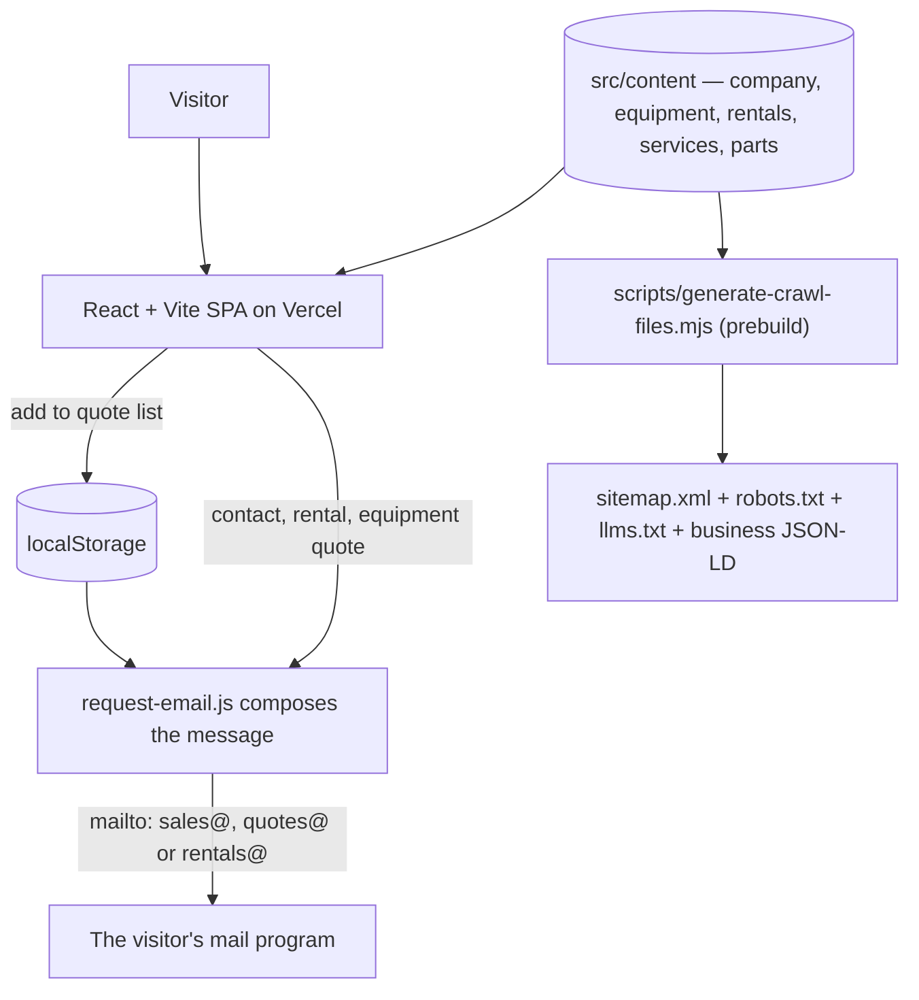

<p align="center">
  
</p>

<h1 align="center">Southbelt Repair and Supply</h1>

<p align="center">
  <b>Concrete batch plants, the parts that keep them running, and the crews that fix them.</b>
</p>
<p align="center">
  The site for Southbelt Repair &amp; Supply Co. Inc.<br />
  Staged at <a href="https://southbelt.taylorurl.com">southbelt.taylorurl.com</a>, built to move to
  <a href="https://southbeltinc.com">southbeltinc.com</a>.
</p>
<p align="center">
  <sub>Published for reading. Proprietary — see <a href="LICENSE.md">LICENSE.md</a>. Outside contributions are not accepted.</sub>
</p>

<p align="center">
  
  
  
  
  
  
</p>

<br />

## Why Southbelt

A visitor arrives with one of four jobs: a plant to buy, a part to replace, a machine that has stopped, or equipment to rent for a few weeks. Each one has a page a search engine can index, and each ends in an email addressed to the desk that handles it, composed in the visitor's own mail program.

### Three desks, one form

Plant and equipment quotes go to `quotes@`, rentals to `rentals@`, and parts, service and everything else to `sales@`. The contact form changes its address as the topic changes, and every quote button on an equipment page opens a message to the quotes desk with the model already in the subject line.

### A quote list, not a checkout

Parts collect in a list held in the browser, each line carrying the part number, brand and the plant it goes on. One message reaches the parts counter with everything needed to price it.

### A page per machine and per part

The eleven machines and the parts catalog are each their own indexable URL with `Product` structured data, which is what someone searching a model name or a part number lands on. Every machine page carries its brochure as a PDF.

### No server, no database, no analytics

Forms hand a composed message to the mail program, and the quote list lives in `localStorage`. There is no server-side data to secure and nothing counting visitors.

<br />

## Stack

| Layer | Technology |
| :--- | :--- |
| UI | React 19 + React Router 7 |
| Build & dev | Vite 7 |
| Styling | Tailwind CSS 3 + PostCSS |
| Icons | `lucide-react` |
| Attribution rail | `@taylorurl/split-rail`, the shared footer bar every TaylorURL site carries |
| Type | Archivo ExtraBold Italic for display, Archivo for headings and labels, Inter for text, all self-hosted from `public/fonts` with metric-matched local fallbacks |
| Content | Plain JS modules under `src/content` |
| Theming | CSS custom properties in `src/index.css`, light and dark, Tailwind reads the same tokens |
| SEO | Per-route meta and JSON-LD from `src/lib`; sitemap, robots.txt, llms.txt, the business JSON-LD and the robots meta generated at `prebuild` |
| State | React context over `localStorage` for the quote list and the theme choice |
| Backend | None — requests leave as `mailto:`; the one function under `api` reports the deployed commit |
| Telemetry | An error reporter in `index.html`, posting to the TaylorURL monitor |
| Hosting | Vercel |

## Getting started

```bash
npm install
npm run dev           # Vite dev server on port 5173
npm run build         # regenerate the crawl files, then build to dist/
```

No environment configuration is required to run the site locally. The project reads two variables, `VITE_SITE_URL` and `VITE_SITE_INDEXABLE`, documented in `.env.example`; both only matter in a deployed environment — see [Which domain the site claims](#which-domain-the-site-claims).

### Scripts

| Script | Does |
| :--- | :--- |
| `npm run dev` | Start the Vite dev server on port 5173. |
| `npm run prebuild` | `scripts/generate-crawl-files.mjs`. Reads the content modules and writes `public/sitemap.xml`, `public/robots.txt`, `public/llms.txt`, and the business JSON-LD block, the robots meta tag and the Equipment panel's destinations inside the repo's own `index.html`. npm runs it ahead of `build`; those files are tracked, so a build leaves them rewritten in the working tree. |
| `npm run build` | Run `prebuild`, build to `dist/`, then write the stylesheet into the built `index.html`. |
| `npm run preview` | Serve the production build. |
| `npm run lint` | Lint with ESLint. |
| `npm run lint:fix` | Lint and auto-fix. |
| `npm run format` | Format `src/**` with Prettier. |
| `npm run format:check` | Check formatting without writing. |

## Architecture



## How it works

- **Content is the database.** The modules under `src/content` hold every fact the site states — the company and its three yards, the eleven machines and their specifications, the used listings, the rental fleet, the five services, the part categories, the parts catalog, the brands, and the questions. Pages, structured data, and the sitemap all read from the same modules, so a fact is stated once.
- **A request is an email, not a POST.** `src/lib/request-email.js` composes the contact, rental and quote messages, picks the desk from the topic, and hands the message to the visitor's mail program. The plain text is built separately from the `mailto:` link so the page can show it on screen — a machine with no mail client configured still leaves the visitor something to copy.
- **One business, three yards.** The structured data describes one `Organization` with each yard as a `LocalBusiness` department carrying its own address and number, so search shows three places under one name.
- **Colour is a token, not a value.** `src/index.css` holds three layers: the navy, sky, tan and iron ramps as primitives, semantic names for what a value is for, and the component classes that consume them. A theme is a block of semantic values and nothing else. The navy and black bands stay dark in both themes, and tan is used as text only on those dark grounds.
- **Indexing is one switch.** Until `VITE_SITE_INDEXABLE` is `true`, robots.txt disallows everything, the shell carries `noindex, nofollow`, and every route writes the same.
- **Nothing about a customer is stored server-side.** The quote list and the theme choice live in `localStorage`. One script in `index.html` leaves the page — the error reporter — and the privacy page describes it.

## Project structure

```
southbeltinc-com/
├── api/
│   └── version.js             Reports the commit the running deployment was built from
├── public/
│   ├── brand/                 Logo cuts, Open Graph image, partner logos
│   ├── brochures/             Spec sheets, the line card and the credit application, as PDFs
│   ├── photos/                Company photography, cut to four widths
│   ├── fonts/                 Inter, Archivo and Archivo Italic, self-hosted as variable WOFF2
│   ├── sitemap.xml            Generated by prebuild — edit the script, not this
│   ├── robots.txt             Generated by prebuild
│   └── llms.txt               Generated by prebuild
├── scripts/
│   ├── generate-crawl-files.mjs   Reads the content modules, writes the crawl files, syncs the business JSON-LD, the robots meta and the shell's Equipment panel in index.html
│   └── first-screen.mjs       Runs after the Vite build, writing the stylesheet into dist/index.html so the first screen waits on no other file
├── src/
│   ├── content/               Everything the site states as fact
│   │   ├── company.js         Name, desks, the three yards, rating, reviews, and the indexing switch
│   │   ├── photos.js          Every photo's cuts and original size
│   │   ├── equipment.js       The eleven machines and the groups they are filed under
│   │   ├── equipment-specs.js Each machine's figures and specification lists, from its brochure
│   │   ├── used-equipment.js  The used listings and their disclaimer
│   │   ├── rentals.js         The rental fleet, the steps and the questions
│   │   ├── services.js        The five services, their detail and their slugs
│   │   ├── part-categories.js The groups the catalog is filed under
│   │   ├── parts.js           The catalog and the search over it
│   │   ├── brands.js          The brands the company works with
│   │   └── faq.js             Questions answered on the home and parts pages
│   ├── lib/
│   │   ├── seo.js             Per-route title, meta, canonical, robots, and JSON-LD
│   │   ├── structured-data.js Organization, Service, Product, Breadcrumb, FAQ blocks
│   │   ├── request-email.js   Composes the contact, rental and quote messages and picks the desk
│   │   ├── contact-form.js    The shared contact fields, their rules, and their messages
│   │   ├── theme.js           Reads, applies, and stores the light/dark choice
│   │   ├── quote-context.js   The quote list context and its hook
│   │   ├── chunk-recovery.js  Reloads a tab still holding a build the host has replaced
│   │   ├── icon-size.js       The three sizes an icon is drawn at
│   │   └── local-time.js      The company's own clock, which the footer's year is read on
│   ├── components/
│   │   ├── layout/            The frame every page is drawn inside: Layout, Header and its Equipment panel, ActionRail, Footer, ThemeToggle, Logo
│   │   ├── sections/          Blocks a page composes: PageHeader, SectionHeading, EquipmentCard, PartCard, PartTile, LocationCards, BrandRow, FaqList, Breadcrumbs, CallToAction
│   │   ├── media/             Photo, which picks the cut for the screen
│   │   ├── forms/             The shared field kit: FormField, ContactFields, FormErrorSummary, SentRequest
│   │   └── app/               What App.jsx mounts around the routes: QuoteProvider, ScrollToTop, ClickSpark, RouteFallback
│   ├── index.css              The token layer, the base states, and the component classes
│   ├── pages/                 One file per route
│   ├── App.jsx                Route table, every page but the home page behind its own chunk
│   └── main.jsx               Browser entry
└── vercel.json                SPA rewrite for cold loads, and how long each asset caches
```

## Editing content

Adding a machine means appending an object to `equipment` in `src/content/equipment.js` and its specifications under the same slug in `src/content/equipment-specs.js`, with its photo in `photos.js` and its brochure under `public/brochures`. The equipment index, the header panel, the detail route and the sitemap all pick it up from there.

Adding a part means appending an object to `parts` in `src/content/parts.js`. It needs a `slug`, a `category` matching one in `src/content/part-categories.js`, the `brands` the counter carries for it, a `summary`, a `description`, an `askFor` list of what a quote needs, and `keywords` for the on-site search.

A used listing is an entry in `src/content/used-equipment.js`; take it out when it sells.

A `slug` is a public URL. Add and retire them; renaming one breaks whatever already links to it.

### Capitalization

Two cases, split by what the text does:

- **Title Case** for anything that names a thing or an action: buttons, nav items, form labels, tabs, card titles, and the `name` field on every machine, service, part, and category. "Request a Quote", "Portable Storage Pigs", "Plant and Part Details". Articles, coordinating conjunctions, and short prepositions stay lowercase unless they open or close the label.
- **Sentence case** for anything that reads as a sentence: page headlines, body copy, list items, the hint under a field, and the `summary` and `description` fields.

## Before launch

`src/content/company.js` is the checklist. A field left empty is hidden rather than rendered blank, so the site works while it is incomplete.

- **Hours:** empty on purpose. The company's own pages disagree, and the right hours have to come from the company before any are published.
- **Brochure addresses:** several spec sheets under `public/brochures` still print the old Houston address. They are the company's files and are served as they are.
- **Indexing:** set `VITE_SITE_URL` and `VITE_SITE_INDEXABLE` together when the site moves to `southbeltinc.com`.
- **Rating:** the Google rating and review count in `company.rating` carry the date they were read; update both together.

## Deployment

Vercel, building from `main`. `vercel.json` rewrites every path to `index.html` so a client-side route resolves on a cold load, and the defaults Vercel detects for a Vite project are the right ones:

| Setting | Value |
| :--- | :--- |
| Framework preset | Vite |
| Build command | `npm run build` (runs `prebuild` first) |
| Output directory | `dist` |
| Install command | `npm ci` |
| Node version | 22, from `engines` in `package.json` |

### How long each asset caches

Without a `Cache-Control` of its own, Vercel serves a file as `max-age=0, must-revalidate`, so every view of every page goes back to the network for the whole bundle and every photo. `vercel.json` sets these policies instead:

| Path | Policy | Why |
| :--- | :--- | :--- |
| `/assets/*` | one year, `immutable` | Vite puts a content hash in the filename, so a changed file is a new URL |
| `/brand/*`, `/photos/*`, `/brochures/*` | one hour, then a week of `stale-while-revalidate` | The filenames are stable, so a replaced photo or spec sheet has to be able to reach a returning visitor |
| `/fonts/*` | one year, `immutable` | The year is what makes a re-subset font a new filename rather than an edit in place |
| The icons and the manifest | the same hour and week | Same reason, and the same fixed names: `favicon.ico`, `apple-touch-icon.png`, `site.webmanifest`, and the four PNG icons |
| Everything else | Vercel's default | `index.html` carries the current asset hashes and has to be re-read on every visit for a deploy to land |

### Which domain the site claims

`VITE_SITE_URL` sets the origin used by canonical tags, Open Graph URLs, the sitemap, the structured data, and the `Sitemap:` line in robots.txt. Unset, it falls back to `https://southbelt.taylorurl.com`.

`VITE_SITE_INDEXABLE` decides whether search engines may index the site at all. Anything but `true` builds the staging copy described above.

Moving the site to `southbeltinc.com` is two environment variables and a redeploy:

```bash
vercel env add VITE_SITE_URL production        # https://southbeltinc.com
vercel env add VITE_SITE_INDEXABLE production  # true
```

Then add the staging domain to the project as a redirect, so any link shared in the meantime follows along.

## License

Copyright (c) 2026 TaylorURL LLC. All rights reserved. See [LICENSE.md](LICENSE.md).

<br />

<p align="center">
  <sub>Concrete batch plants, parts, service and rentals from Houston, San Marcos and Dallas.</sub>
</p>
